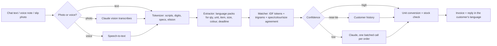

# Parchi

**An order desk for wholesalers.** Retailers send orders the way they talk: a WhatsApp line in Spanish, a voice note, Arabic with Arabic numerals, a photo of a handwritten slip. Parchi reads the order, matches every line to the right product, checks stock, and hands back an invoice and a reply in the customer's own language.

> "Hola, necesito 2 cajas de grapadoras 24/6, 5 docenas de papel de regalo rojo, 10 paquetes de grapas 24/6 y 6 rollos de cinta de embalaje. Para mañana por favor"
>
> → 4 matched lines · 24 pcs, 60 pcs, 10 pkts, 6 rolls · gift wrap short by 20 · invoice with 15% tax · due tomorrow · read in milliseconds

**Live demo:** https://claude.ai/artifact/HiDLiNUbpPLqL7FykEkN2y

All data in the demo is fictional: the distributor (Meridian Trading Co.), its customers and its stock.

## The problem

Small retailers order from wholesalers through chat: messages, voice notes and photos of handwritten slips, in their own language and full of local trade words. At the wholesaler, someone reads every message, works out which product each line means, checks stock, and retypes the order into billing software. QuickBooks, Xero and Zoho make good invoices; they all assume someone has already done that retyping.

## What it does

| | |
|---|---|
| **Reads messy orders in 7 languages** | English, Spanish, Portuguese, French, Arabic, Indonesian and Hindi. Number words (*docena*, *dúzia*, *douzaine*, *عشرة*, *lusin*), trade units (*caja*, *caixa*, *carton*, *كرتونة*), several scripts and digit systems, and misspellings (*sciccors*, *notbook*, *padlok*). |
| **Shows its work** | Every quantity, item word and size is highlighted on the original message, linked to the line it produced. |
| **Matches to products** | Picks the right variant from specs (24/6 vs No.10 staples, 9 W vs 12 W bulbs, 6x8 vs 8x10 frames), colour and size, with a confidence score. |
| **Knows the customer** | When a variant is genuinely ambiguous, the customer's past orders settle it ("same as last time"). |
| **Asks only when unsure** | Unclear lines are flagged for a one-click check, or sent to Claude in one batched call. Photos of handwritten slips are transcribed by Claude. |
| **Checks stock** | Flags shortfalls and can bill what is in stock while backordering the rest. |
| **Makes the invoice** | Tax at each item's rate, zero-rated exports, tax summary, amount in words, yearly numbering (INV-2026-0143). Currency and tax rates are settings. |
| **Replies on WhatsApp** | A confirmation in the customer's language. |
| **Runs the counter** | Invoices and collections, live stock, a reorder list for the next supplier order, and a weekly view of value, channels and languages. |

## How it works



**Rules first, model on doubt.** The engine (`src/engine`, pure TypeScript, no dependencies) reads a typical order in a few milliseconds and costs nothing per line. A language model is used only for photos and for the lines the rules cannot settle.

- **Tokenizer** keeps specs whole (`24/6`, `No.10`, `6x8`, `USB-C`), normalises Arabic-Indic and other digits and Arabic letter variants, strips French elision, and splits order lines on commas, conjunctions in each language, dashes and new lines.
- **Extractor** is a state machine over a lexicon built from **language packs** (`src/engine/global.ts`): number words, units, colours, sizes, fillers and deadline words per language. Adding a market means adding a pack.
- **Matcher** scores every product by IDF-weighted fuzzy token coverage plus character-trigram similarity against trade names in every supported language, then adds or subtracts for specs, colour and size. Text similarity is capped so only real agreement on specs can push a variant ahead of its siblings.
- **Invoicing** (`src/engine/invoice.ts`) charges tax per line at the product's rate, zero-rates export customers, merges repeated items and writes the amount in words.

## Tech stack

- **App:** React 18 + TypeScript, built by Vite into one self-contained page. Custom CSS design system with light and dark themes and right-to-left support.
- **Engine:** pure TypeScript, shared unchanged between the browser, tests and the server.
- **AI:** Claude for photo transcription and doubtful-line resolution (batched JSON prompts, answers checked against the candidate list).
- **Production path:** Supabase Postgres with row-level security, `pg_trgm`, `pgvector` and `pgmq`; Deno Edge Functions for parsing and the WhatsApp Cloud API webhook.
- **Tests:** Vitest, 31 tests across tokenizer, extraction in every language, matching, units, invoicing and stock.

## Scalability

- **Per-order cost is near zero.** Most lines never touch a model; one batched call covers all doubtful lines in an order.
- **Multi-tenant from day one.** Every table is keyed by `business_id` and protected by row-level security.
- **Bursts don't block.** The WhatsApp webhook stores the message (idempotent on the WhatsApp message id) and enqueues a parse job in `pgmq`.
- **Large catalogs.** `pg_trgm` pre-filters candidates in the database (`match_candidates()`); `pgvector` is ready for semantic fallback.
- **Correct under concurrency.** Invoice numbers come from an atomic per-year counter; stock moves are written in the same transaction as the invoice.

## Business model

| Plan | Price | For |
|---|---|---|
| Starter | $0 | 40 orders a month, text orders, invoices |
| Shop | $19 / month | Unlimited text orders, 300 photo/voice reads, stock and collections |
| Warehouse | $59 / month | WhatsApp Business inbox, unlimited reads, several warehouses, accounting export |

## Run it

```bash
npm install
npm run dev          # local dev server
npm test             # engine tests
npm run build        # single-file build in dist/ and artifact/
npm run sync:engine  # copy the engine into supabase/functions/_shared for Deno
```

## Repository layout

```
src/engine/      order engine: tokenizer, language packs, extractor, matcher, units, invoicing, stock, AI prompts
src/data/        sample catalog, customers and inbox (all fictional)
src/ui/          React app: desk, invoices, stock, week, plans
tests/           Vitest suite
supabase/        Postgres schema with RLS, Edge Functions (parse-order, whatsapp-webhook)
scripts/         build helpers, screenshot tour, demo recording, video assembly
```

Built for the Next Founders Hackathon (October 2026). MIT licensed.
